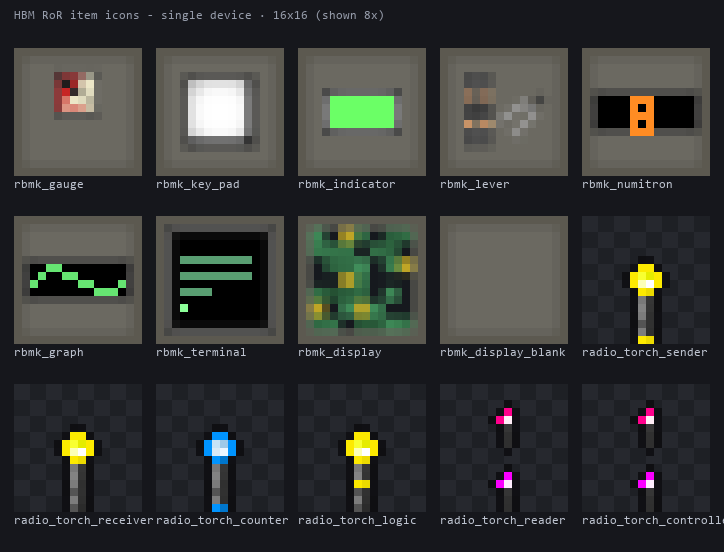

# RoR 元件物品图标（16×16 · 单个仪表）

给 HBM 的无线红石（Redstone-over-Radio）元件画的一套物品图标，**不是手绘**：
用前几轮提取的模型 + 原贴图做正交正面投影，渲染到 16×16（8× 超采样后 box 降采样），
所以图标和游戏里的方块是同一套造型、同一套材质。

**图标里只放一个元件**（单个表盘 / 单个按钮 / 单盏灯 / 单块屏），放大居中到面板面上，
2×2 或六联的实装排布另存在 `icons_16_cluster/` 里做备选。

源：`HbmMods/Hbm-s-Nuclear-Tech-GIT` @ `bf238d8`（LGPLv3）



## 图标清单（15 个）

| 文件 | 方块 | 图标内容（单件） |
|---|---|---|
| `icons_16/rbmk_gauge.png` | 无线红石信号流量控制器面板 | 一个表盘（含红色刻度扇区 + 指针） |
| `icons_16/rbmk_key_pad.png` | 无线红石信号按钮面板 | 一个按钮（带倒角） |
| `icons_16/rbmk_indicator.png` | 无线红石信号指示灯 | 一盏透镜，点亮为绿 |
| `icons_16/rbmk_lever.png` | 无线红石信号拉杆 | 一组拉杆（挂板 + 手柄，手柄按 50° 倾角） |
| `icons_16/rbmk_numitron.png` | 无线红石信号数字显示器 | 一块数码屏，屏内琥珀色 `8` |
| `icons_16/rbmk_graph.png` | 无线红石信号图表面板 | 一块屏，屏内绿色折线 |
| `icons_16/rbmk_terminal.png` | 无线红石信号发信终端 | 单屏，屏内 3 行绿字 + 光标 |
| `icons_16/rbmk_display.png` | RBMK 显示面板 | 7×7 彩色网格 |
| `icons_16/rbmk_display_blank.png` | 无线红石信号空白面板 | 纯面板（`rbmk_display.png` 原贴图） |
| `icons_16/radio_torch_*.png` ×6 | 无线红石发射器/接收器/计数器/逻辑接收器/读取器/控制器 | 直接用方块贴图（本身是火把造型），底部对齐 + 1px 暗描边 |

## 单件图标的取景（为什么这么摆）

| 元件 | 最长边占面板面 | 姿态处理 |
|---|---|---|
| gauge | 0.64 | 指针按 `RenderRBMKGauge` 的 `rot(angle-85, -X, pivot(0,0.4375,-0.125))`，取 angle=0 → 绕 +X 85° |
| key_pad | 0.58 | 按钮帽补倒角（上/左提亮、下/右压暗），避免纯白一片 |
| indicator | 0.62 | 透镜占位偏小，留出灯座 |
| lever | 0.74 | 手柄按 `LeverVertical` 的 `rot(-50*(curLevel/50-1), X, pivot(0,0.1,0))`，取 curLevel=0 → +50° |
| numitron / graph | 0.84 | 屏是扁宽的，按原始比例铺 |
| terminal | 0.86 | 单件本身就是整块终端 |

其余规则：面板面用 `rbmk_display.png` 铺满 1×1（16×16 时 1:1 像素对齐）；
元件法线朝相机一侧用 `0.72 + 0.45·max(0,n·L)` 做轻微明暗；`alpha<0.35` 剔除保留镂空；
屏幕内容（数字 / 折线 / 文本）在 16×16 网格上逐像素补绘。

## 规格与目录

- `icons_16/` —— **16×16 RGBA 透明底**，MC 物品图标标准尺寸，可直接丢 `textures/items/`
- `icons_16_cluster/` —— 备选：按 `face_layout.obj` 的实装排布（4 拉盘 / 4 按钮 / 6 灯 / 2 拉杆 / 2 屏）
- `icons_32/`、`icons_64/` —— 单件版的最近邻整数放大（GUI / HUD / 文档用，不插值）
- `previews/` —— 每个图标 16× 放大；`*_cluster.png` 是备选版
- `sheet_8x.png` / `sheet_cluster_8x.png` —— 两套总览（8× 棋盘底）
- `textures/` —— 用到的原贴图；`gallery.html` —— 带图索引

## 用在自己的资源包里

```
assets/<yourmodid>/textures/items/<name>.png     ← icons_16/*.png
```

## 复现

```bash
python F:\DSH\work\build_icons.py        # 渲染 + 导出 16/32/64 + 两套 + zip
python F:\DSH\work\gen_icon_sheet.py     # 两张总览图 + gallery.html
```
