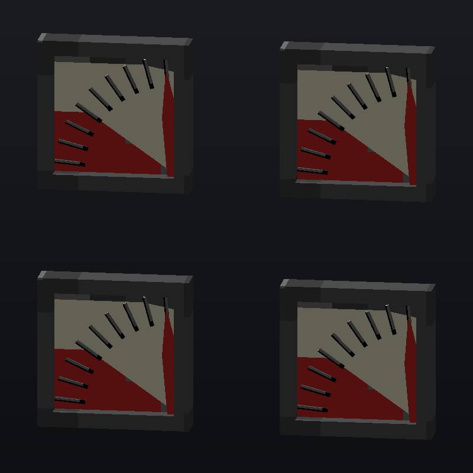
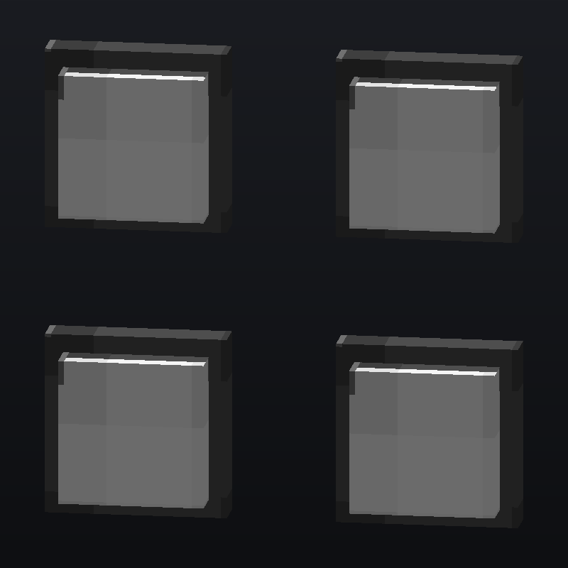
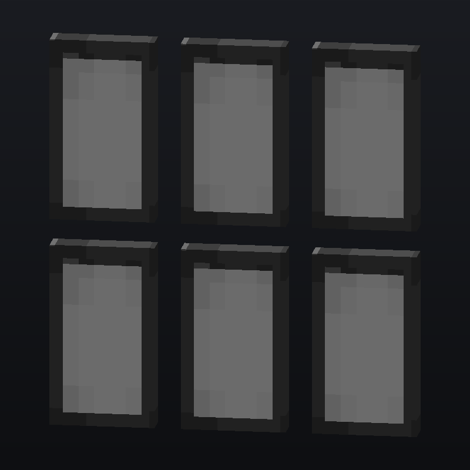
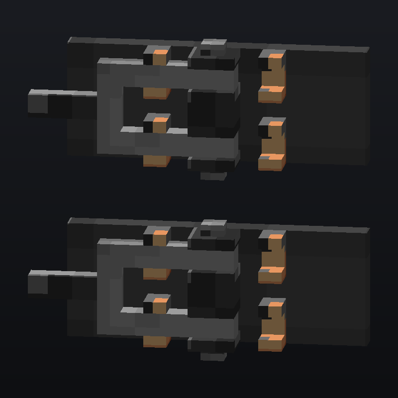
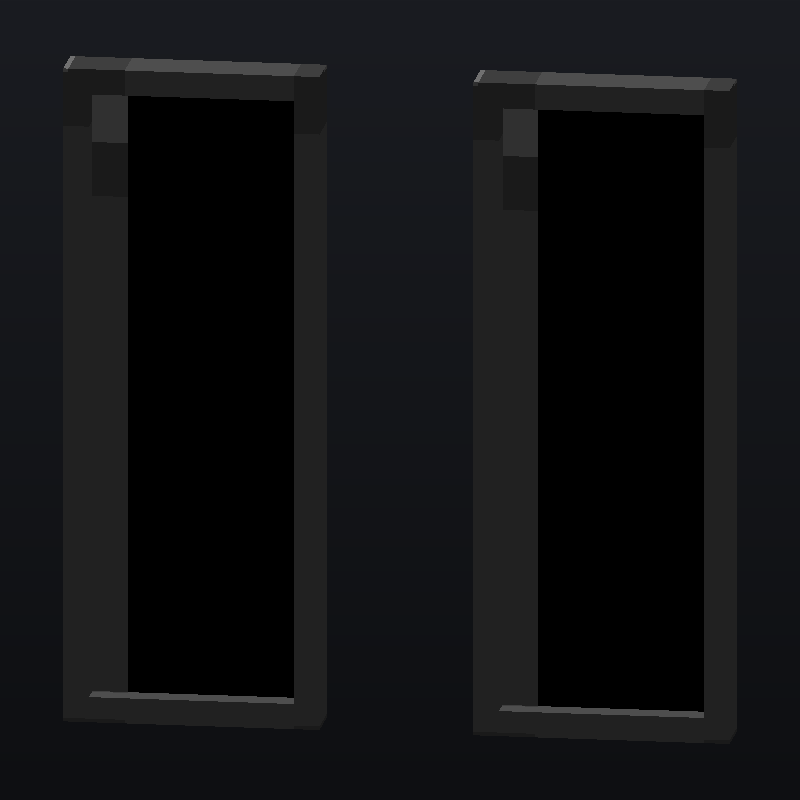
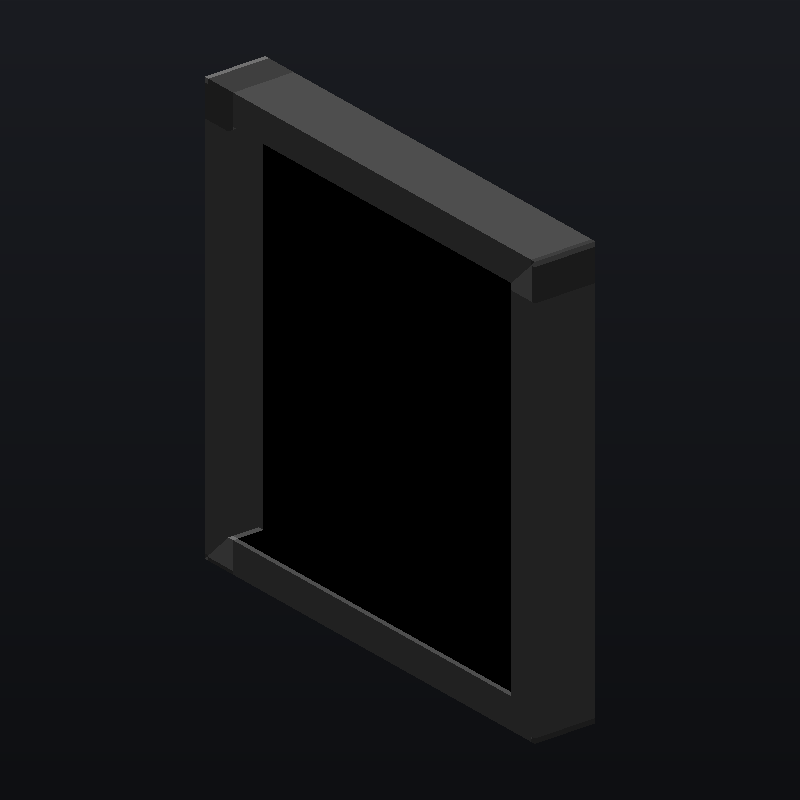
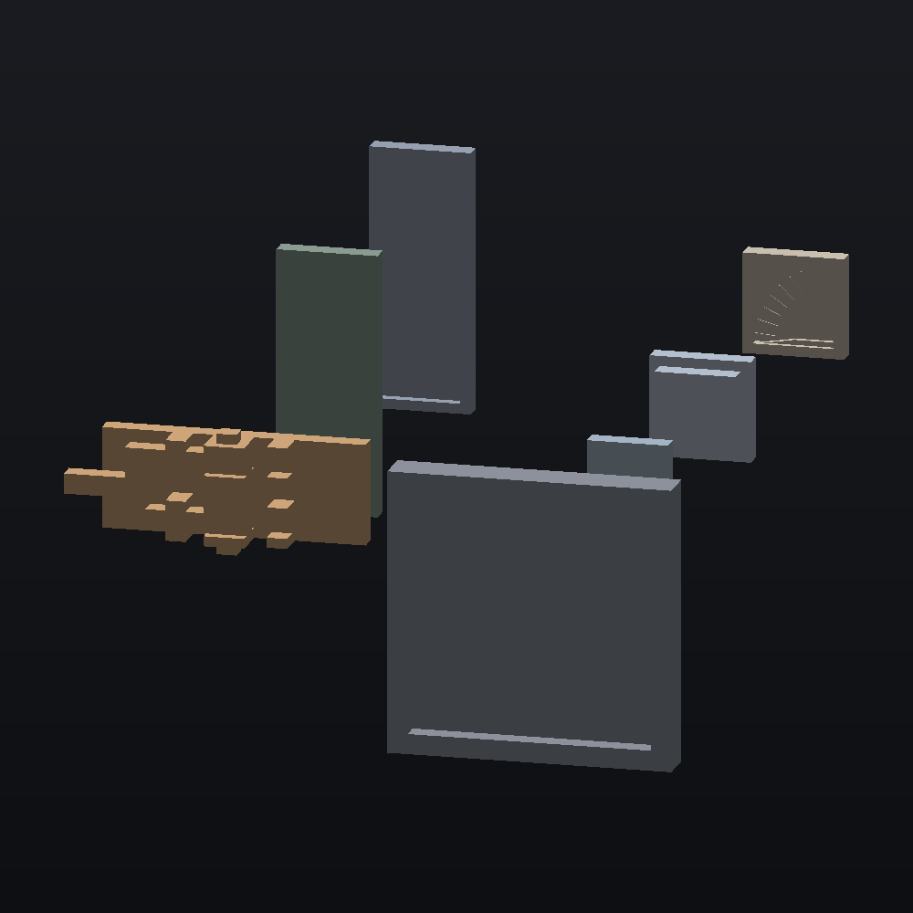

# 无线红石（Redstone-over-Radio）单方块面板 —— 只要表面件

范围：`zh_CN.lang` 里名字带「无线红石」的**单方块**方块 + 它们的表面模型。
排除多格的 `rbmk_console`（4×1×5 多格占位）与 `rbmk_display`（名字是「RBMK显示面板」，不在关键词内）。

源：`HbmMods/Hbm-s-Nuclear-Tech-GIT` @ `bf238d8`，LGPLv3。

## 一句话结论

这 7 个面板的 `.obj` **本来就不含方块箱体**——箱子是 `RBMKMiniPanelBase.renderWorldBlock()` 用
`RenderBlocksNT` 单独画的 0.25 厚方块（贴 `hbm:rbmk/rbmk_display`），obj 里全都是**长在方块正面上的零件**。
所以「剔方块」在这里不需要动刀：模型即表面件。我另外把它们按 mod 的排布拼成了**方块正面的实装图**
（`face_layout.obj`），这才是你在游戏里看到的那一面。

实测包围盒（单位=方块，1.0=16px），没有任何一件接近 1×1 的箱体：

| 方块 | object 部件 | 面数 | unit 数 | 排布后总面数 | 单件包围盒 |
|---|---|---|---|---|---|
| `rbmk_gauge` 流量控制器面板 | Gauge, Needle | 129 | 4 | 516 | 0.0625 × 0.3125 × 0.3125 |
| `rbmk_key_pad` 按钮面板 | Socket, Button | 20 | 4 | 80 | 0.125 × 0.3125 × 0.3125 |
| `rbmk_indicator` 指示灯 | Base, Light | 18 | 6 | 108 | 0.0625 × 0.25 × 0.4375 |
| `rbmk_lever` 拉杆 | Base, Lever | 202 | 2 | 404 | 0.1875 × 0.9062 × 0.375 |
| `rbmk_numitron` 数字显示器 | Plane | 26 | 2 | 52 | 0.0625 × 0.3125 × 0.8125 |
| `rbmk_graph` 图表面板 | Plane（复用 numitron） | 26 | 2 | 52 | 0.0625 × 0.3125 × 0.8125 |
| `rbmk_terminal` 发信终端 | Base | 26 | 1 | 26 | 0.125 × 0.875 × 0.875 |

另有 6 个**无线红石火把**方块（发射器/接收器/控制器/读取器/计数器/逻辑接收器），是纯立方体，
没有 obj，只有 6 面贴图 → 见 `radio_torch/textures/`。

## 目录

```
hbm_ror_single_block/
├─ rbmk_gauge/
│  ├─ face_layout.obj        方块正面的实装排布（4 个表盘，2×2）★要的就是这个
│  ├─ rbmk_gauge_surface.obj 单个表盘（不带排布）
│  ├─ parts/Gauge.obj, parts/Needle.obj
│  ├─ textures/gauge.png
│  └─ previews/layout_front.png, layout_iso.png, unit_iso.png
├─ rbmk_key_pad/  rbmk_indicator/  rbmk_lever/
├─ rbmk_numitron/ rbmk_graph/      rbmk_terminal/     （结构同上）
├─ radio_torch/textures/     6 个火把方块的 rtty_*.png（开关两态）
├─ panel_block_face_reference/rbmk_display.png   方块自身的面（不属于表面件，仅供对照）
├─ RBMKMiniPanelBase.java    方块本体/厚度/朝向的权威代码
└─ index.json
```

每个 obj 都写好了 `mtllib` + `usemtl`，贴图在同目录 `textures/` 下，拖进 Blender 直接带图。

## 坐标约定（TESR 空间）

```java
glTranslatef(x + 0.5f, y, z + 0.5f);     // 原点 = 方块中心、底面
switch(meta) { 2: rotY90; 4: rotY180; 3: rotY270; 5: rotY0; }
// 之后按 unit 偏移摆零件，不做整体缩放
```

`face_layout.obj` 已经把这些 unit 偏移烘进顶点，**原样导入即得到方块正面**（x 轴朝面板法线，
零件落在 x≈0.25/0.31，即方块面所在位置）。各方块的 unit 偏移：

| 方块 | unit 平移 | 动画量 |
|---|---|---|
| gauge | `(0.25, 0.25-0.5·(i/2), 0.25-0.5·(i%2))` i=0..3 | Needle 绕 -X 转 `angle-85`，已按 angle=0 烘入 |
| key_pad | 同上 i=0..3 | 按下时 Button 沿 +X 移 `-0.03125`（导出为未按下） |
| indicator | `(0.25, 0.3125-0.3125·(i/2), 0.25-0.5·(i%2))` i=0..5 | Light 为满亮面片 |
| lever | `(0.25, 0, 0.25-0.5·i)` i=0..1 | Lever 手柄 pivot `(0.125,0.5625,0)` 绕 Z 转 `-180·progress`（导出为 0） |
| numitron / graph | `(0.25, 0.25-0.5·i, 0)` i=0..1 | 数字/曲线由代码画，不在模型里 |
| terminal | `(0.25, 0, 0)` | 文字行 `translate(0, 10·scale, 0)` 滚动 |

## 预览

| | |
|---|---|
|  |  |
| gauge（4 表盘） | key_pad（4 按钮） |
|  |  |
| indicator（6 灯） | lever（2 拉杆） |
|  |  |
| numitron（2 屏） | terminal（单屏） |

## 元件库（all_components/）

`all_components/RoR_components.obj` —— **7 种元件、447 面合在一个模型里**，按 1.15 的网格间距摆开，
每个 object 名就是 `方块_object`（如 `rbmk_gauge_Gauge`、`rbmk_lever_Lever`），
MTL 里每个方块一个材质（`MAT_rbmk_gauge` → `textures/gauge.png`），导入即带全部 6 张贴图。

| object 前缀 | 元件 | 对应贴图 |
|---|---|---|
| `rbmk_gauge_Gauge` / `_Needle` | 表盘壳+刻度 / 指针 | gauge.png |
| `rbmk_key_pad_Socket` / `_Button` | 按钮座 / 按钮帽 | keypad.png |
| `rbmk_indicator_Base` / `_Light` | 灯座 / 发光面片 | indicator.png |
| `rbmk_terminal_Base` | 终端框体 | terminal.png |
| `rbmk_numitron_Plane` / `rbmk_graph_Plane` | 数码屏 / 图表屏（同一模型） | numitron.png |
| `rbmk_lever_Base` / `_Lever` | 拉杆挂板 / 手柄 | lever.png |



## 打包

整个目录已打成 `F:\DSH\work\HBM_RoR_panel_models.zip`（约 237 KB，含模型、贴图、预览、README、gallery）。

```bash
python F:\DSH\work\build_ror.py     # 生成各方块目录
python F:\DSH\work\pack_ror.py      # 合并元件库 + 打 zip
```

## 复现

```bash
python F:\DSH\work\build_ror.py
```

脚本：解析 obj → 按 object 拆件 → 按渲染器的 unit 偏移复制并烘进 `face_layout.obj`
（gauge 的指针按 renderer 的 `rot(-85°, -X, pivot)` 烘焙）→ 软件光栅化出预览。
