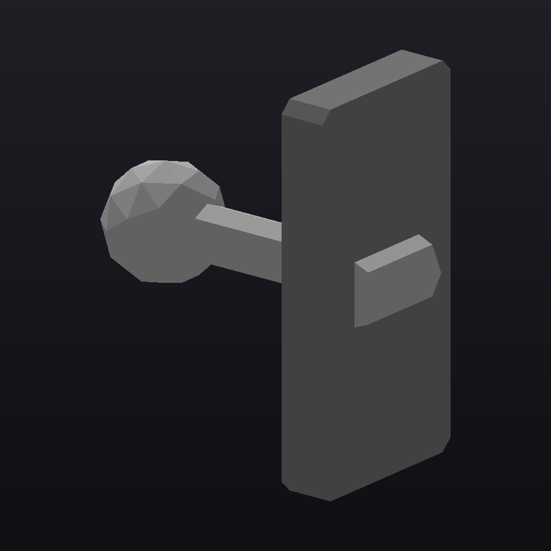
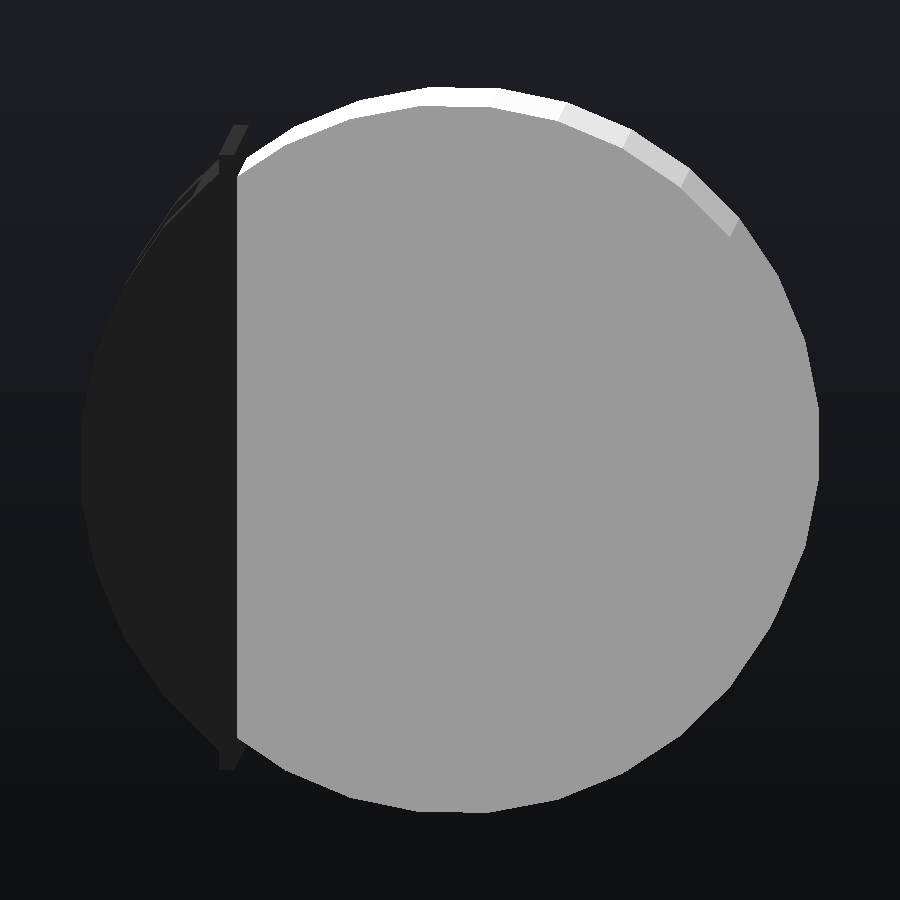
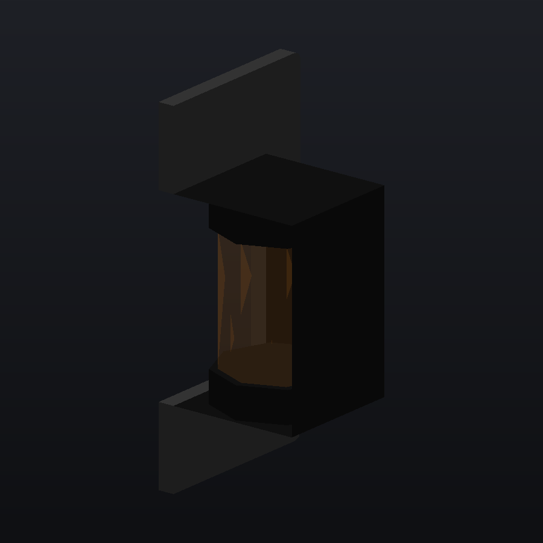
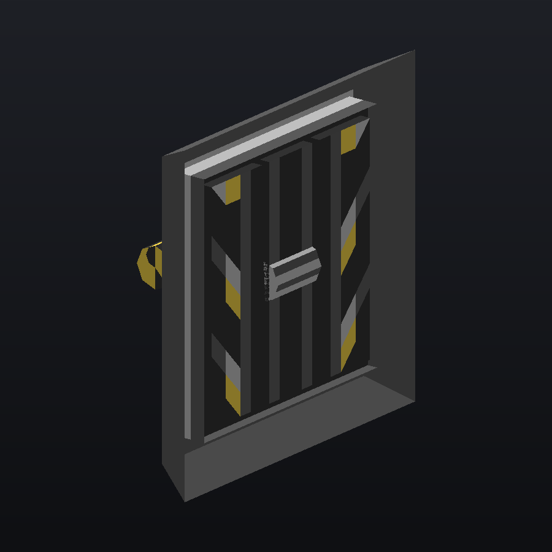
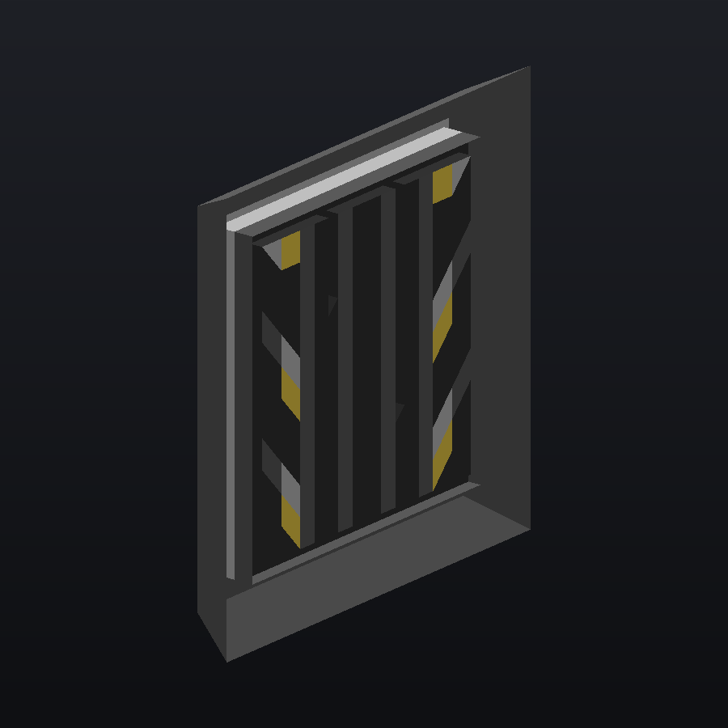
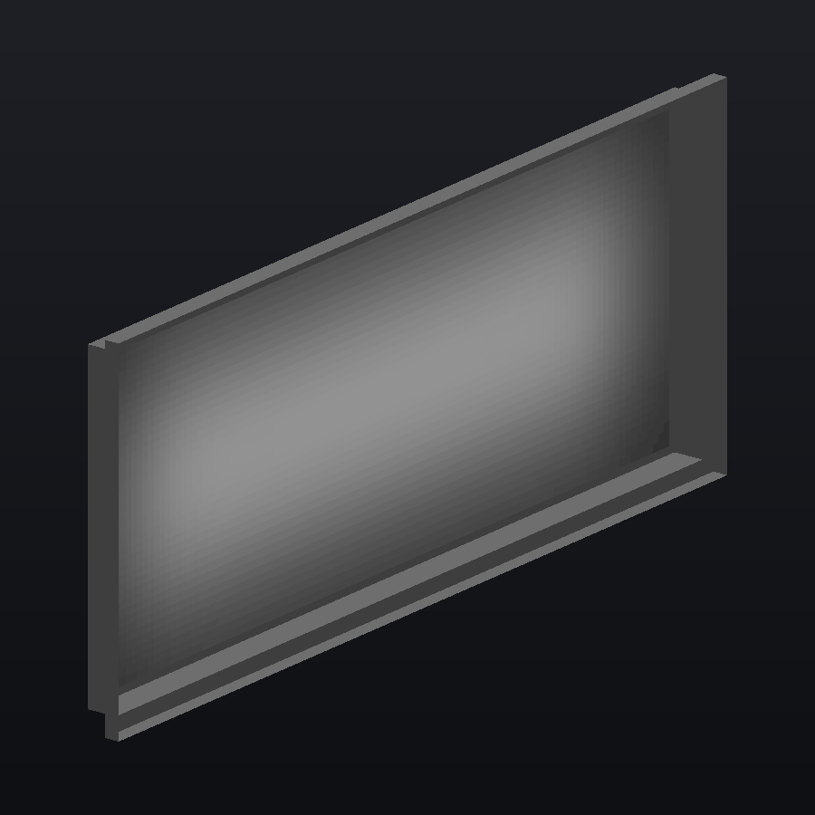

# NTM Cursed Addon —— 自定义控制面板仪表模型

来源：`https://github.com/ntmleafia/NTM-Cursed-Addon` @ `c085b54`（2026-10-27）
原始路径：`src/main/resources/assets/leafia/textures/_integrated/control_panel/instruments/`
许可：源文件 SPDX 头为 `LicenseRef-PolyForm-Shield-1.0.0`（文本已附 `LICENSES/`）；作者已授权使用。

## 这些是什么

Cursed Addon 给 NTM 的**控制面板（Control Panel）**加了 11 个自定义控件，
其中 **6 个是自定义 `.obj` 模型**（其余 RBMK Display / Graph / Boxed Label / MeterHorizontal 是代码画的面片）。
这 6 个模型统一由 `AddonInstrumentModels` 加载，各自的 `render()` 里写死了部件名、颜色和动画支点。

| 模型 | 控件 / 注册名 | 部件（object） | 面数 | 控件尺寸 (getSize) | 模型缩放 |
|---|---|---|---|---|---|
| `lever.obj` | Vertical/Horizontal Lever · `leafia_lever_v` / `_h` | Base, Base.001, Lever | 184 | 1×2×1.25 / 2×1×1.25 | scale 0.5 |
| `meter_vertical.obj` | Vertical Meter · `leafia_meter_v` | Base, Meter, Needle | 270 | 1.7×5×1.25 | 1.0 |
| `nixie.obj` | Nixie Tube · `leafia_nixie` | Border, BorderLeft, Screws, Inside, InsideLeft, Tube, ClipPlane | 166 | 1.75×2.5×0.0625（每位） | 1.0 |
| `starboundbuttonlol.obj` | Large Button · `leafia_sbbutton` | Plane, Plane.001, Plane.002, Circle, **Circle.001**（按帽） | 218 | 6×6×0.5 | scale 3 |
| `starboundswitchlol.obj` | Large Switch · `leafia_sbswitch` | Plane, Plane.001, Plane.002, Cube, **Switch**（拨杆） | 222 | 6×6×0.5 | scale 3 |
| `textindicator.obj` | Text Indicator · `leafia_textindicator` | Plane（机身）, **Plane.001**（灯面） | 34 | 4.5×1.8×0.25 | scale 1/1.5 |

> 注意：这些模型**基本不靠贴图**——`render()` 里绑的是 `AddonBase.solid`（1×1 白图），颜色全靠
> `LeafiaGls.color(r,g,b)` 逐部件着色。真正用贴图的只有 starbound 两个（`largeswitch_palette.png`）
> 和 textindicator 的灯面（`textindicator_light.png`）。所以我把代码里的颜色写进了每个 `.mtl` 的 `Kd`。

## 部件颜色（来自源码 render()）

| 模型 | 部件 → 颜色 |
|---|---|
| lever | Base `0.306` · Base.001 `0.765` · Lever `0.533` |
| meter_vertical | Base `0.1` · Meter `1.0` · Needle `1.0` |
| nixie | Border/BorderLeft `0.1` · Screws `0.5` · Inside/InsideLeft `0.02` · Tube `(1, 0.462, 0.076)` α=0.2 · ClipPlane 不可见 |
| starbound×2 | 全部 → `largeswitch_palette.png` |
| textindicator | Plane `0.29` · Plane.001 → `textindicator_light.png`（叠加发光） |

## 动画支点（照抄就能复现动起来的效果）

| 模型 | 动作 |
|---|---|
| lever | `translate(0, 0.1, 0)` → `rotate(-50*(curLevel/50-1), 1,0,0)` → `translate(0, -0.1, 0)` 再画 Lever；水平版整体 `rotateY(-90)` |
| meter_vertical | `translate(0,-1.75,0)` → `rotate(-needleOffset*(360/32),1,0,0)` 画 Needle，再 `rotate(curAngle)` 画 Meter；刻度线由代码用 quad 画 |
| nixie | 每位 `translate(i, 0, 0)`；BorderLeft/Screws/InsideLeft 只在首尾位，末位再 `rotateY(180)`；Tube 用 blend 叠 alpha |
| starbound button | 按下时 `Circle.001` `translate(0,-0.125,0)`；未点亮整体乘 0.5 灰 |
| starbound switch | `translate(0,0.125,0)` → `rotate(-65*(1-curLevel/50),1,0,0)` → `translate(0,-0.125,0)` 画 Switch |
| textindicator | Plane.001 画两遍：基础色 + `blendFunc(SRC_ALPHA, ONE)` 的发光层，α = `(t/duration)^0.5` |

## 目录

```
hbm_leafia_control_panel_instruments/
├─ models/<模型>/        <name>.obj + <name>.mtl（每个 object 一个材质，带颜色/贴图）
│   └─ parts/            逐 object 拆件（Base.obj、Circle_001.obj…），可单独取用
├─ textures/             instruments/ 下全部 14 张贴图（含 7 张 meter 表盘 GUI 图与各 GUI 图）
├─ previews/             每个模型 iso + front 两张预览
├─ java/                 6 个仪表的类 + AddonInstrumentModels/Register/ControlType + Lever/Meter 变体
├─ LICENSES/             LicenseRef-PolyForm-Shield-1.0.0.txt
├─ index.json            面数/部件/包围盒/尺寸/动画说明
└─ README.md
```

## 预览

| | |
|---|---|
|  |  |
| lever（带球头手柄） | meter_vertical（圆盘表 + 指针） |
|  |  |
| nixie（深色玻璃管，Tube 半透明） | starbound switch（调色板贴图） |
|  |  |
| starbound button | textindicator（灯面） |

预览是脚本内的软件光栅化（正交视角 + 兰伯特着色），深色件的亮度做了提升以便看清结构，
实际游戏里由控制面板的光照决定。

## 复现

```bash
python F:\DSH\work\build_leafia.py
```

脚本做的事：扫 `instruments/*.obj` → 解析 object/部件 → 按源码颜色写 `.mtl` → 逐件导出 →
多材质软件渲染预览 → 抄一份 java 源码 → 打 zip。

## 顺带说明

同目录下的其它 5 个控件（`leafia_rbmk`、`leafia_graph`、`leafia_drawing_box`、`leafia_meter_h`、
以及 `leafia_lever_h` 的水平变体）**没有独立模型文件**，是复用上面这些 obj 或纯代码绘制，
所以本包不含它们的额外几何。
