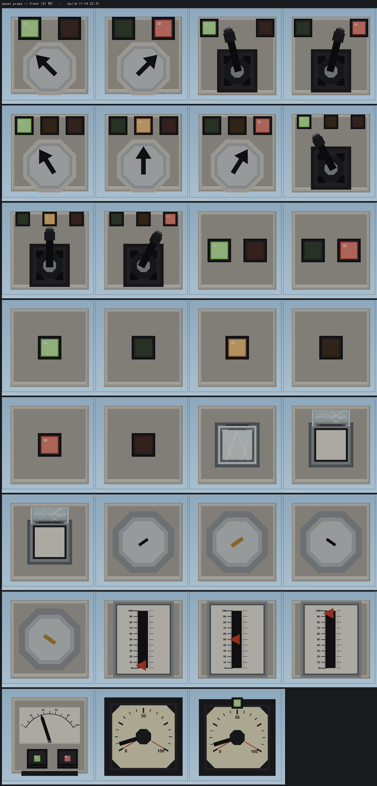
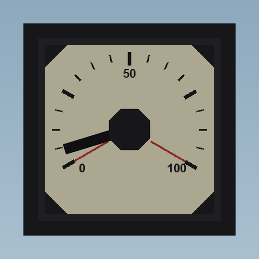
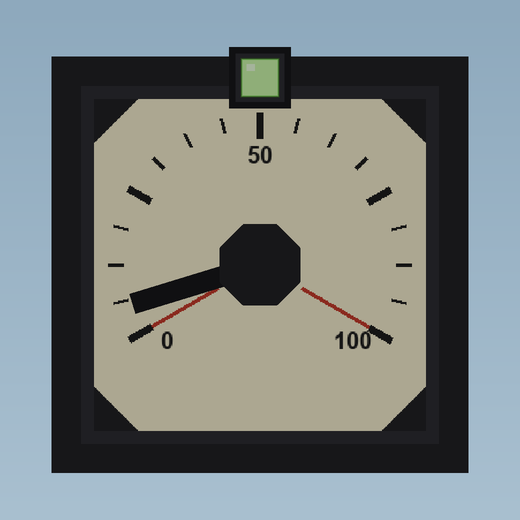
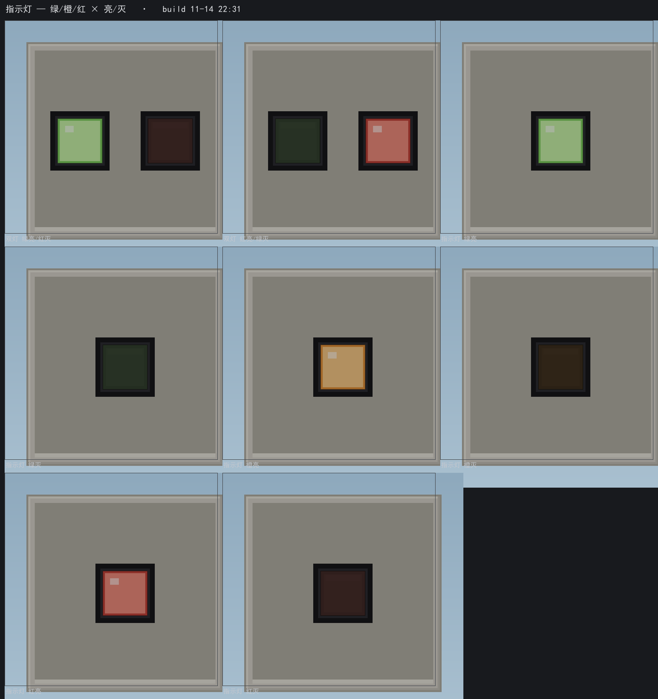
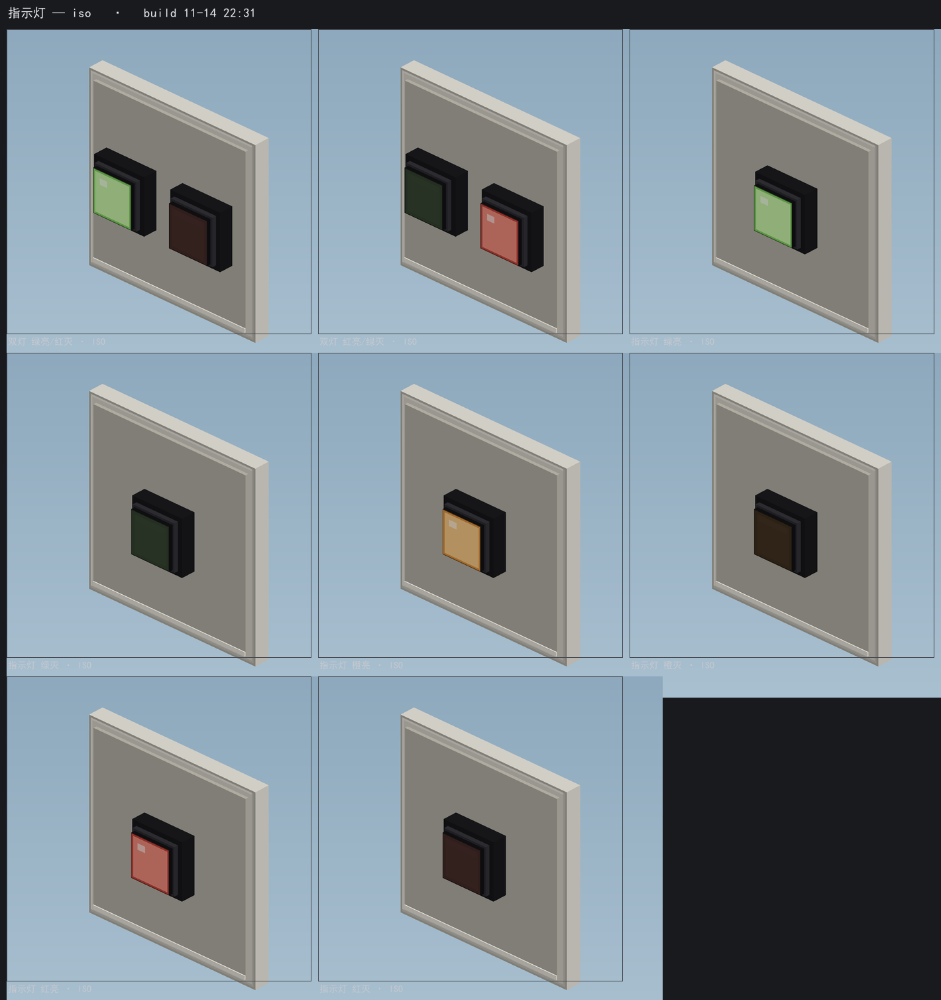
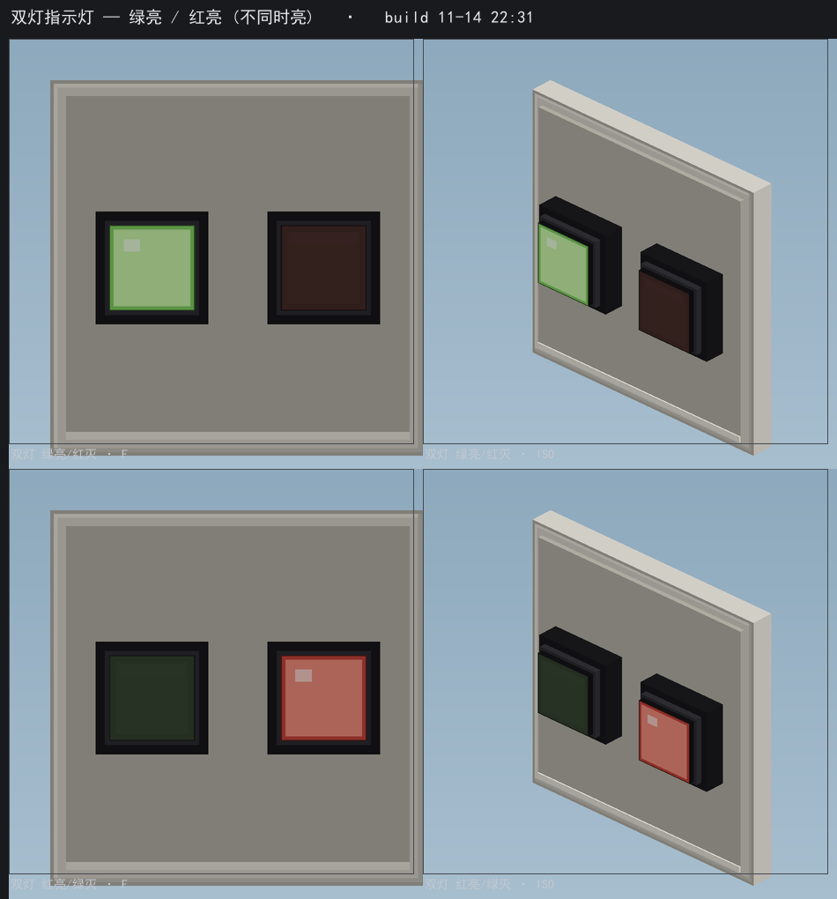
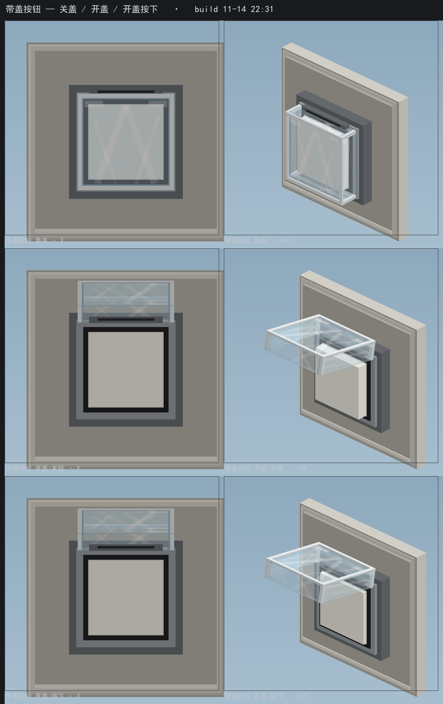
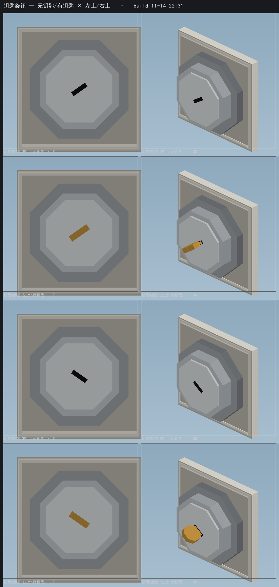
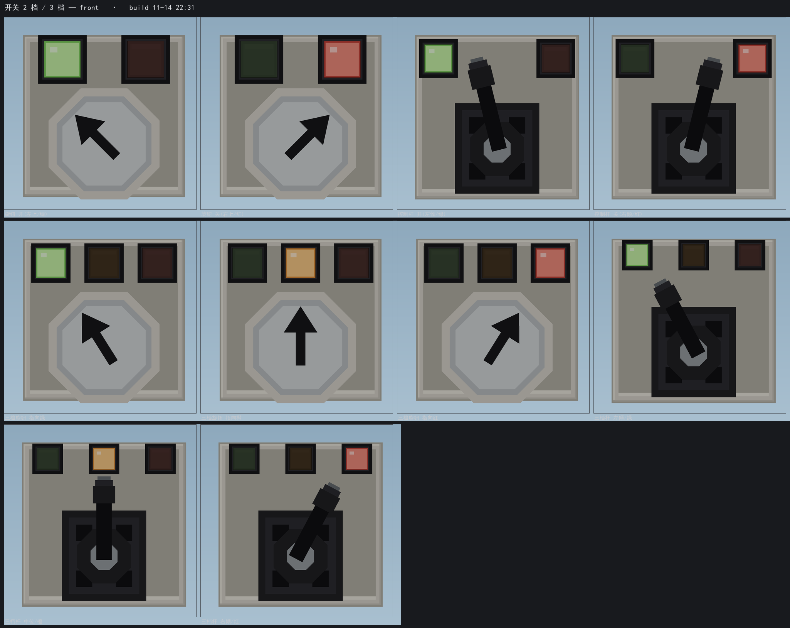
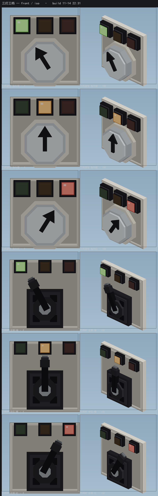

# 控制面板仪表件 · OBJ + 贴图

按你给的 6 张参考截图做的 **4 类低多边形工业仪表 + 开关的两档/三档两套**，几何与贴图全部由 `gen.py` 程序化生成，
并在 Blockbench 里打开校验过几何/朝向/贴图映射。

**没有做任何文字**（除了仪表的数字刻度），灯是正方形，旋钮是真正的八边形。



---

## 一、交付内容（一件一个文件夹）

每个文件夹**自包含**：`.obj` + `.mtl` + `.png` + `README.txt`（写明该件的状态、枢轴、贴图）。
直接把需要的文件夹整个丢进资源包即可，不用再改路径。

```
panel_props/
  01_knob_switch_2pos/     旋钮开关（两档）   open / close
  02_knob_switch_3pos/     旋钮开关（三档）   green / orange / red
  03_lever_switch_2pos/    控制杆（两档）     open / close
  04_lever_switch_3pos/    控制杆（三档）     green / orange / red
  05_indicator_single/     指示灯（单灯）     绿/橙/红 × 亮/灭（6 个）
  06_indicator_double/     双灯指示灯         绿亮 / 红亮（互斥）
  07_gauge_vertical/       立式仪表 0-100    指针 0 / 50 / 100
  08_gauge_arc_buttons/    弧表 + 双按钮
  09_cover_button/         带玻璃盖按钮       closed / open / pressed
  README.md                本文件
  previews/                全部预览图（front / iso / 拼图）
```

* 共 **31 个 OBJ**、12 个文件夹。
* 贴图按“族”共用：`01/02/05/06/09/10` 都用 `knob_switch.png`，`03/04` 用 `lever_switch.png`，
  `07` 用 `gauge.png`，`08` 用 `gauge_buttons.png`——所以同一族的文件夹里贴图是同一份（复制一份即可省显存）。
* `out/obj/` 是生成器的平铺工作目录（预览就是它渲染的），交付请看 `out/models/` 或压缩包。

---

### 1h) 扇形刻度仪表 `gauge_fan`

按你给的黑色方框表做的：黑框 + 象牙表盘（四角切角）+ 17 条刻度 + 一根黑粗指针 + 黑轴心。
**没有任何单位文字**（原图的 `F³/秒` 已去掉），只保留 `0 / 50 / 100` 三个数字。

* 刻度：0..100 映射到 **210° → −30°**（240° 扇区），角度 = `210 − 240 × v/100`；每 4 条一根长刻度。
* **0 与 100 那两条红线不是指针**，是画在表盘贴图上的范围线：从轴心附近（r≈0.15 盘宽）连到刻度圈，
  角度正好 210° 与 −30°，所以模型里没有第二根针、也不用动画。
* 指针：只有一根黑色粗针，绕 **(0.5000, 0.5000, −0.1875)** 转，当前 **197°**（近 0 端）；`o Needle` 独立组。
* 尺寸：框 12.8×12.8，表盘 10.2×10.2，凸出 3.3 单位（0.21 格）。
* 表盘贴图单独一张 `gauge_fan.png`（512×512，只用了左上 288px 区域）。



### 1i) 扇形刻度仪表（带顶灯）`gauge_fan_lamp`

和 `11_gauge_fan` **完全一样**的表盘（17 条刻度、0/100 红线、黑指针、黑轴心），只在**顶部中间加了一盏绿色方形指示灯**：

* 灯位 (8, 13.75)：灯座 1.9 方形、内框 1.5、灯面 1.2，凸出到 z −3.52，和指示灯同规格。
* 灯跨在黑框上沿（框到 14.4），上半截露在框外——和参考图里那颗黑色圆头的位置一致。
* 灯面 UV 指向本件贴图里的 `gl_on` 区域（带中心提亮 + 左上高光）；想做熄灭状态就把它指到暗色区域。
* 表盘贴图单独一张 `gauge_fan_lamp.png`（512×512）。



---

## 二、坐标约定（重要）

| 项 | 值 |
|---|---|
| 单位 | **1.0 = 1 个方块**（0.0625 = 原版 16px 里的 1px） |
| 上方向 | **+Y** |
| 正面朝向 | **−Z**（模型从 z=0 的安装面向 −z 凸出，最多约 0.30 格） |
| 包围盒 | x ∈ [0,1]、y ∈ [0,1]、z ∈ [−0.44, 0]，正好占满一格 |
| 左右 | **+X 是观察者的左手侧**（正面朝 −Z 时）。绿灯、开方向都在 +X 这一侧 |

Blockbench 的单位是 **16 = 1 方块**（`gen.py` 里的数字就是 0–16 这套），两边换算 ×16 即可。

---

## 三、4 组模型

### 1) 旋钮开关 `knob_switch_*`

* 面板 + 两盏**正方形**灯（灯座 4.2 单位、灯面 3.2 单位正方形，黑框 + 亮面）。
* 旋钮 = **八边形**棱柱三层（底盘 9.6 / 身体 8.2 / 顶盖 7.2 单位宽），
  每层都是「2 条十字带 + 4 片 45° 倒角薄板」拼的正八边形，侧面能看到倒角斜面。
* 顶盖上一条黑色**箭头**（方杆 + 三角形的头），随状态绕轴转 ±45°：
  * 开 → 箭头指**左上**，绿灯亮、红灯灭
  * 关 → 箭头指**右上**，红灯亮、绿灯灭

### 1c) 指示灯 `indicator_*`

直接把旋钮开关那套**底板 + 一盏灯**拿来，灯挪到正中 **(8, 8)**，别的没动：

* 底板、边框、灯的灯座/内框/灯面**完全相同**（灯座 4.2、灯面 3.2 单位，凸出 3.18 单位）。
* **没有重绘贴图**：直接复用 `knob_switch.png` 里已有的 `g/o/r` × `on/off` 六块灯面区域和面板斜边。
* 三个颜色 × 亮/灭 = 6 个 OBJ，想用哪个直接拿。




### 1d) 双灯指示灯 `indicator2_*`

同一个底板，横向并排两盏灯：**观察者左 = 绿，右 = 红**，**两个状态互斥**，同一时间只亮一盏：

| 文件 | 绿 | 红 |
|---|---|---|
| `indicator2_green.obj` | **亮** | 灭 |
| `indicator2_red.obj` | 灭 | **亮** |

* 灯位：绿 (11.2, 8.0)、红 (4.8, 8.0)，灯座 4.2 / 灯面 3.2，和单灯版、旋钮开关完全同规格（中间留 2.2 空隙）。
* 贴图仍是 `knob_switch.png`，零新增区域。
* 想让两个都灭（故障/断电）或都亮（自检），直接拿这两个 OBJ 把某一盏的灯面 UV 换成 `*_off` / `*_on` 即可——几何不用动。



### 1f) 带玻璃罩的按钮 `cover_button_*`

底板 + 灰色方座 + 白色按钮 + **五面玻璃罩**。罩子把按钮**整个罩住**（前/左/右/上/下五面玻璃
+ 四角铬柱 + 前框），玻璃是**真半透明**，合上时透过罩子能看到里面的按钮；罩子绕顶后沿铰链翻开。

| 文件 | 玻璃罩 | 按钮 |
|---|---|---|
| `cover_button_closed.obj` | 合上（0°） | 弹起（隔着玻璃可见） |
| `cover_button_open.obj` | 翻开 **100°** | 弹起 |
| `cover_button_pressed.obj` | 翻开 **100°** | **按下**（往面板里压 0.62 单位） |

尺寸（单位 = 1/16 方块）：

* 壳体 8.0×8.0，凸出 1.35；按钮帽 5.2×5.2，弹起时高出壳体 1.12。
* 玻璃罩外形 **6.8 × 6.8 × 1.68**，玻璃板厚 0.24，铬框 0.30；罩内净空 6.3。
* 铰链在 **(8, 11.40, −2.90)**；翻开 100° 后向前伸出 **0.60 格**（合上 0.29 格），y 方向不出方块。

**玻璃单独一张贴图 `glass.png`（256×256，带 alpha）**，所以这个文件夹里有两张图：

```
09_cover_button/
  cover_button_*.obj     ← 里面用 usemtl prop / usemtl glass 两个材质
  knob_switch.mtl        ← newmtl prop(map_Kd knob_switch.png) + newmtl glass(map_Kd glass.png)
  knob_switch.png        ← 不透明部分（壳体/按钮/面板）
  glass.png              ← 玻璃（RGBA，中心 alpha≈58，反光条 alpha≈86）
```

渲染时把 `glass` 材质放到**半透明批次**（开混合、后画、不写深度）就能正确透视；
`glass.png` 的 alpha 想更透就把整张 alpha 乘个系数（现在的基底是 58/255 ≈ 0.23）。



### 1g) 钥匙旋钮 `key_switch_*`

三段圆柱旋钮（外圈 11.0 / 中段 8.8 / 顶盖 7.4），顶面一条细长锁孔。插钥匙版本按真实钥匙的样子做：

* **锁孔** 1.9 × 0.5 长槽；**钥匙片垂直于锁孔插进去**（1.65 × 0.36，深 1.6，插进旋钮 0.15）；
* **露在外面的是实心八边形钥匙柄**：外径 **2.4**（比钥匙片 1.65 略宽）、厚 **0.70**，
  和钥匙片**同一个平面**（法线朝上/下）——所以正视只看到一条横边，俯视/斜视才看到八边形。
* 八边形**和锁孔、钥匙片一起转** ∓35°（整体绕旋钮轴刚性旋转），不是固定不动的。

| 文件 | 钥匙 | 方向 |
|---|---|---|
| `key_switch_open_nokey.obj` | 无 | 锁孔长槽朝**左上**（−35°） |
| `key_switch_close_nokey.obj` | 无 | 锁孔长槽朝**右上**（+35°） |
| `key_switch_open_key.obj` | 有 | 钥匙片 −35° |
| `key_switch_close_key.obj` | 有 | 钥匙片 +35° |

* 全部绕 **(0.5000, 0.5000, −0.2906)** 绕 Z 轴转 ∓35°，八边形柄在 z −7.30…−4.90。
* 凸出（整体）：无钥匙 4.7 单位（0.29 格），插钥匙 7.3 单位（0.46 格）。



### 1h) 扇形刻度仪表 `gauge_fan`

按你给的黑色方框表做的：黑框 + 象牙表盘（四角切角）+ 17 条刻度 + 一根黑粗指针 + 黑轴心。
**没有任何单位文字**（原图的 `F³/秒` 已去掉），只保留 `0 / 50 / 100` 三个数字。

* 刻度：0..100 映射到 **210° → −30°**（240° 扇区），角度 = `210 − 240 × v/100`；每 4 条一根长刻度。
* **0 与 100 那两条红线不是指针**，是画在表盘贴图上的范围线：从轴心附近（r≈0.15 盘宽）连到刻度圈，
  角度正好 210° 与 −30°，所以模型里没有第二根针、也不用动画。
* 指针：只有一根黑色粗针，绕 **(0.5000, 0.5000, −0.1875)** 转，当前 **197°**（近 0 端）；`o Needle` 独立组。
* 尺寸：框 12.8×12.8，表盘 10.2×10.2，凸出 3.3 单位（0.21 格）。
* 表盘贴图单独一张 `gauge_fan.png`（512×512，只用了左上 288px 区域）。


### 1i) 扇形刻度仪表（带顶灯）`gauge_fan_lamp`

和 `11_gauge_fan` **完全一样**的表盘（17 条刻度、0/100 红线、黑指针、黑轴心），只在**顶部中间加了一盏绿色方形指示灯**：

* 灯位 (8, 13.75)：灯座 1.9 方形、内框 1.5、灯面 1.2，凸出到 z −3.52，和指示灯同规格。
* 灯跨在黑框上沿（框到 14.4），上半截露在框外——和参考图里那颗黑色圆头的位置一致。
* 灯面 UV 指向本件贴图里的 `gl_on` 区域（带中心提亮 + 左上高光）；想做熄灭状态就把它指到暗色区域。
* 表盘贴图单独一张 `gauge_fan_lamp.png`（512×512）。


---

## 二、坐标约定（重要）

| 项 | 值 |
|---|---|
| 单位 | **1.0 = 1 个方块**（0.0625 = 原版 16px 里的 1px） |
| 上方向 | **+Y** |
| 正面朝向 | **−Z**（模型从 z=0 的安装面向 −z 凸出，最多约 0.30 格） |
| 包围盒 | x ∈ [0,1]、y ∈ [0,1]、z ∈ [−0.44, 0]，正好占满一格 |
| 左右 | **+X 是观察者的左手侧**（正面朝 −Z 时）。绿灯、开方向都在 +X 这一侧 |

Blockbench 的单位是 **16 = 1 方块**（`gen.py` 里的数字就是 0–16 这套），两边换算 ×16 即可。

---

## 三、4 组模型

### 1) 旋钮开关 `knob_switch_*`

* 面板 + 两盏**正方形**灯（灯座 4.2 单位、灯面 3.2 单位正方形，黑框 + 亮面）。
* 旋钮 = **八边形**棱柱三层（底盘 9.6 / 身体 8.2 / 顶盖 7.2 单位宽），
  每层都是「2 条十字带 + 4 片 45° 倒角薄板」拼的正八边形，侧面能看到倒角斜面。
* 顶盖上一条黑色**箭头**（方杆 + 三角形的头），随状态绕轴转 ±45°：
  * 开 → 箭头指**左上**，绿灯亮、红灯灭
  * 关 → 箭头指**右上**，红灯亮、绿灯灭

### 1c) 指示灯 `indicator_*`

直接把旋钮开关那套**底板 + 一盏灯**拿来，灯挪到正中 **(8, 8)**，别的没动：

* 底板、边框、灯的灯座/内框/灯面**完全相同**（灯座 4.2、灯面 3.2 单位，凸出 3.18 单位）。
* **没有重绘贴图**：直接复用 `knob_switch.png` 里已有的 `g/o/r` × `on/off` 六块灯面区域和面板斜边。
* 三个颜色 × 亮/灭 = 6 个 OBJ，想用哪个直接拿。


### 1d) 双灯指示灯 `indicator2_*`

同一个底板，横向并排两盏灯：**观察者左 = 绿，右 = 红**，**两个状态互斥**，同一时间只亮一盏：

| 文件 | 绿 | 红 |
|---|---|---|
| `indicator2_green.obj` | **亮** | 灭 |
| `indicator2_red.obj` | 灭 | **亮** |

* 灯位：绿 (11.2, 8.0)、红 (4.8, 8.0)，灯座 4.2 / 灯面 3.2，和单灯版、旋钮开关完全同规格（中间留 2.2 空隙）。
* 贴图仍是 `knob_switch.png`，零新增区域。
* 想让两个都灭（故障/断电）或都亮（自检），直接拿这两个 OBJ 把某一盏的灯面 UV 换成 `*_off` / `*_on` 即可——几何不用动。


### 1f) 带玻璃罩的按钮 `cover_button_*`

底板 + 灰色方座 + 白色按钮 + **五面玻璃罩**。罩子把按钮**整个罩住**（前/左/右/上/下五面玻璃
+ 四角铬柱 + 前框），玻璃是**真半透明**，合上时透过罩子能看到里面的按钮；罩子绕顶后沿铰链翻开。

| 文件 | 玻璃罩 | 按钮 |
|---|---|---|
| `cover_button_closed.obj` | 合上（0°） | 弹起（隔着玻璃可见） |
| `cover_button_open.obj` | 翻开 **100°** | 弹起 |
| `cover_button_pressed.obj` | 翻开 **100°** | **按下**（往面板里压 0.62 单位） |

尺寸（单位 = 1/16 方块）：

* 壳体 8.0×8.0，凸出 1.35；按钮帽 5.2×5.2，弹起时高出壳体 1.12。
* 玻璃罩外形 **6.8 × 6.8 × 1.68**，玻璃板厚 0.24，铬框 0.30；罩内净空 6.3。
* 铰链在 **(8, 11.40, −2.90)**；翻开 100° 后向前伸出 **0.60 格**（合上 0.29 格），y 方向不出方块。

**玻璃单独一张贴图 `glass.png`（256×256，带 alpha）**，所以这个文件夹里有两张图：

```
09_cover_button/
  cover_button_*.obj     ← 里面用 usemtl prop / usemtl glass 两个材质
  knob_switch.mtl        ← newmtl prop(map_Kd knob_switch.png) + newmtl glass(map_Kd glass.png)
  knob_switch.png        ← 不透明部分（壳体/按钮/面板）
  glass.png              ← 玻璃（RGBA，中心 alpha≈58，反光条 alpha≈86）
```

渲染时把 `glass` 材质放到**半透明批次**（开混合、后画、不写深度）就能正确透视；
`glass.png` 的 alpha 想更透就把整张 alpha 乘个系数（现在的基底是 58/255 ≈ 0.23）。


### 1g) 钥匙旋钮 `key_switch_*`

三段圆柱旋钮（外圈 11.0 / 中段 8.8 / 顶盖 7.4），顶面一条细长锁孔；插钥匙版本多一把黄铜钥匙。
**按真实钥匙插进锁里的样子做**：钥匙片垂直于锁孔插进去，露在外面的只有**八边形钥匙环**。

| 文件 | 钥匙 | 方向 |
|---|---|---|
| `key_switch_open_nokey.obj` | 无 | 锁孔长槽朝**左上**（−35°） |
| `key_switch_close_nokey.obj` | 无 | 锁孔长槽朝**右上**（+35°） |
| `key_switch_open_key.obj` | 有 | 钥匙环朝**左上** |
| `key_switch_close_key.obj` | 有 | 钥匙环朝**右上** |

* 锁孔：顶面一条 **1.3 × 0.36** 的细长暗槽（钥匙片的截面），倾斜 ∓35° 表示档位。
* 钥匙片：**1.2 × 0.3**，垂直于锁孔插进去（z −5.30…−4.50，插进旋钮 0.15）。
* 钥匙环：**八边形环**，外径 2.5、板厚 0.45、中孔约 1.6，在 z −5.78…−5.32（露在外面）；
  从正面能透过中孔看到里面的钥匙片，钥匙片的倾斜方向就是档位方向。
* 整把钥匙（片 + 环）绕 **(0.5000, 0.5000, −0.2906)** 绕 Z 轴转 ∓35°。
* 凸出（整体）：无钥匙 4.7 单位（0.29 格），插钥匙 5.78 单位（0.36 格）。


### 1h) 扇形刻度仪表 `gauge_fan`

按你给的黑色方框表做的：黑框 + 象牙表盘（四角切角）+ 17 条刻度 + 一根黑粗指针 + 黑轴心。
**没有任何单位文字**（原图的 `F³/秒` 已去掉），只保留 `0 / 50 / 100` 三个数字。

* 刻度：0..100 映射到 **210° → −30°**（240° 扇区），角度 = `210 − 240 × v/100`；每 4 条一根长刻度。
* **0 与 100 那两条红线不是指针**，是画在表盘贴图上的范围线：从轴心附近（r≈0.15 盘宽）连到刻度圈，
  角度正好 210° 与 −30°，所以模型里没有第二根针、也不用动画。
* 指针：只有一根黑色粗针，绕 **(0.5000, 0.5000, −0.1875)** 转，当前 **197°**（近 0 端）；`o Needle` 独立组。
* 尺寸：框 12.8×12.8，表盘 10.2×10.2，凸出 3.3 单位（0.21 格）。
* 表盘贴图单独一张 `gauge_fan.png`（512×512，只用了左上 288px 区域）。


### 1i) 扇形刻度仪表（带顶灯）`gauge_fan_lamp`

和 `11_gauge_fan` **完全一样**的表盘（17 条刻度、0/100 红线、黑指针、黑轴心），只在**顶部中间加了一盏绿色方形指示灯**：

* 灯位 (8, 13.75)：灯座 1.9 方形、内框 1.5、灯面 1.2，凸出到 z −3.52，和指示灯同规格。
* 灯跨在黑框上沿（框到 14.4），上半截露在框外——和参考图里那颗黑色圆头的位置一致。
* 灯面 UV 指向本件贴图里的 `gl_on` 区域（带中心提亮 + 左上高光）；想做熄灭状态就把它指到暗色区域。
* 表盘贴图单独一张 `gauge_fan_lamp.png`（512×512）。


---

## 二、坐标约定（重要）

| 项 | 值 |
|---|---|
| 单位 | **1.0 = 1 个方块**（0.0625 = 原版 16px 里的 1px） |
| 上方向 | **+Y** |
| 正面朝向 | **−Z**（模型从 z=0 的安装面向 −z 凸出，最多约 0.30 格） |
| 包围盒 | x ∈ [0,1]、y ∈ [0,1]、z ∈ [−0.44, 0]，正好占满一格 |
| 左右 | **+X 是观察者的左手侧**（正面朝 −Z 时）。绿灯、开方向都在 +X 这一侧 |

Blockbench 的单位是 **16 = 1 方块**（`gen.py` 里的数字就是 0–16 这套），两边换算 ×16 即可。

---

## 三、4 组模型

### 1) 旋钮开关 `knob_switch_*`

* 面板 + 两盏**正方形**灯（灯座 4.2 单位、灯面 3.2 单位正方形，黑框 + 亮面）。
* 旋钮 = **八边形**棱柱三层（底盘 9.6 / 身体 8.2 / 顶盖 7.2 单位宽），
  每层都是「2 条十字带 + 4 片 45° 倒角薄板」拼的正八边形，侧面能看到倒角斜面。
* 顶盖上一条黑色**箭头**（方杆 + 三角形的头），随状态绕轴转 ±45°：
  * 开 → 箭头指**左上**，绿灯亮、红灯灭
  * 关 → 箭头指**右上**，红灯亮、绿灯灭

### 1c) 指示灯 `indicator_*`

直接把旋钮开关那套**底板 + 一盏灯**拿来，灯挪到正中 **(8, 8)**，别的没动：

* 底板、边框、灯的灯座/内框/灯面**完全相同**（灯座 4.2、灯面 3.2 单位，凸出 3.18 单位）。
* **没有重绘贴图**：直接复用 `knob_switch.png` 里已有的 `g/o/r` × `on/off` 六块灯面区域和面板斜边。
* 三个颜色 × 亮/灭 = 6 个 OBJ，想用哪个直接拿。


### 1d) 双灯指示灯 `indicator2_*`

同一个底板，横向并排两盏灯：**观察者左 = 绿，右 = 红**，**两个状态互斥**，同一时间只亮一盏：

| 文件 | 绿 | 红 |
|---|---|---|
| `indicator2_green.obj` | **亮** | 灭 |
| `indicator2_red.obj` | 灭 | **亮** |

* 灯位：绿 (11.2, 8.0)、红 (4.8, 8.0)，灯座 4.2 / 灯面 3.2，和单灯版、旋钮开关完全同规格（中间留 2.2 空隙）。
* 贴图仍是 `knob_switch.png`，零新增区域。
* 想让两个都灭（故障/断电）或都亮（自检），直接拿这两个 OBJ 把某一盏的灯面 UV 换成 `*_off` / `*_on` 即可——几何不用动。


### 1f) 带玻璃罩的按钮 `cover_button_*`

底板 + 灰色方座 + 白色按钮 + **五面玻璃罩**。罩子把按钮**整个罩住**（前/左/右/上/下五面玻璃
+ 四角铬柱 + 前框），玻璃是**真半透明**，合上时透过罩子能看到里面的按钮；罩子绕顶后沿铰链翻开。

| 文件 | 玻璃罩 | 按钮 |
|---|---|---|
| `cover_button_closed.obj` | 合上（0°） | 弹起（隔着玻璃可见） |
| `cover_button_open.obj` | 翻开 **100°** | 弹起 |
| `cover_button_pressed.obj` | 翻开 **100°** | **按下**（往面板里压 0.62 单位） |

尺寸（单位 = 1/16 方块）：

* 壳体 8.0×8.0，凸出 1.35；按钮帽 5.2×5.2，弹起时高出壳体 1.12。
* 玻璃罩外形 **6.8 × 6.8 × 1.68**，玻璃板厚 0.24，铬框 0.30；罩内净空 6.3。
* 铰链在 **(8, 11.40, −2.90)**；翻开 100° 后向前伸出 **0.60 格**（合上 0.29 格），y 方向不出方块。

**玻璃单独一张贴图 `glass.png`（256×256，带 alpha）**，所以这个文件夹里有两张图：

```
09_cover_button/
  cover_button_*.obj     ← 里面用 usemtl prop / usemtl glass 两个材质
  knob_switch.mtl        ← newmtl prop(map_Kd knob_switch.png) + newmtl glass(map_Kd glass.png)
  knob_switch.png        ← 不透明部分（壳体/按钮/面板）
  glass.png              ← 玻璃（RGBA，中心 alpha≈58，反光条 alpha≈86）
```

渲染时把 `glass` 材质放到**半透明批次**（开混合、后画、不写深度）就能正确透视；
`glass.png` 的 alpha 想更透就把整张 alpha 乘个系数（现在的基底是 58/255 ≈ 0.23）。


### 1g) 钥匙旋钮 `key_switch_*`

三段圆柱旋钮（外圈 11.0 / 中段 8.8 / 顶盖 7.4），顶面一个方锁孔；插钥匙的版本多一根黄铜细杆。

| 文件 | 钥匙 | 方向 |
|---|---|---|
| `key_switch_open_nokey.obj` | 无 | 孔朝**左上**（−35°） |
| `key_switch_close_nokey.obj` | 无 | 孔朝**右上**（+35°） |
| `key_switch_open_key.obj` | 有 | 杆向**左**歪 |
| `key_switch_close_key.obj` | 有 | 杆向**右**歪 |

* 钥匙就是**仪表指针那根细杆**：0.64 宽 × 3.2 长 × 0.3 厚，纯 `BRASS #b98b3c`，
  从顶面方孔（1.4 × 1.1 的暗孔）里**竖着立起来**，只在板面外凸 0.3 单位，像插在锁里的钥匙柄。
* 整根杆绕 **(0.5000, 0.5000, −0.2990)** 绕 Z 轴转 ∓35°，所以正视就是左歪/右歪。
* 凸出（整体）：无钥匙 4.7 单位（0.29 格），插钥匙 4.95 单位（0.31 格）。


### 1h) 扇形刻度仪表 `gauge_fan`

按你给的黑色方框表做的：黑框 + 象牙表盘（四角切角）+ 17 条刻度 + 一根黑粗指针 + 黑轴心。
**没有任何单位文字**（原图的 `F³/秒` 已去掉），只保留 `0 / 50 / 100` 三个数字。

* 刻度：0..100 映射到 **210° → −30°**（240° 扇区），角度 = `210 − 240 × v/100`；每 4 条一根长刻度。
* **0 与 100 那两条红线不是指针**，是画在表盘贴图上的范围线：从轴心附近（r≈0.15 盘宽）连到刻度圈，
  角度正好 210° 与 −30°，所以模型里没有第二根针、也不用动画。
* 指针：只有一根黑色粗针，绕 **(0.5000, 0.5000, −0.1875)** 转，当前 **197°**（近 0 端）；`o Needle` 独立组。
* 尺寸：框 12.8×12.8，表盘 10.2×10.2，凸出 3.3 单位（0.21 格）。
* 表盘贴图单独一张 `gauge_fan.png`（512×512，只用了左上 288px 区域）。


### 1i) 扇形刻度仪表（带顶灯）`gauge_fan_lamp`

和 `11_gauge_fan` **完全一样**的表盘（17 条刻度、0/100 红线、黑指针、黑轴心），只在**顶部中间加了一盏绿色方形指示灯**：

* 灯位 (8, 13.75)：灯座 1.9 方形、内框 1.5、灯面 1.2，凸出到 z −3.52，和指示灯同规格。
* 灯跨在黑框上沿（框到 14.4），上半截露在框外——和参考图里那颗黑色圆头的位置一致。
* 灯面 UV 指向本件贴图里的 `gl_on` 区域（带中心提亮 + 左上高光）；想做熄灭状态就把它指到暗色区域。
* 表盘贴图单独一张 `gauge_fan_lamp.png`（512×512）。


---

## 二、坐标约定（重要）

| 项 | 值 |
|---|---|
| 单位 | **1.0 = 1 个方块**（0.0625 = 原版 16px 里的 1px） |
| 上方向 | **+Y** |
| 正面朝向 | **−Z**（模型从 z=0 的安装面向 −z 凸出，最多约 0.30 格） |
| 包围盒 | x ∈ [0,1]、y ∈ [0,1]、z ∈ [−0.44, 0]，正好占满一格 |
| 左右 | **+X 是观察者的左手侧**（正面朝 −Z 时）。绿灯、开方向都在 +X 这一侧 |

Blockbench 的单位是 **16 = 1 方块**（`gen.py` 里的数字就是 0–16 这套），两边换算 ×16 即可。

---

## 三、4 组模型

### 1) 旋钮开关 `knob_switch_*`

* 面板 + 两盏**正方形**灯（灯座 4.2 单位、灯面 3.2 单位正方形，黑框 + 亮面）。
* 旋钮 = **八边形**棱柱三层（底盘 9.6 / 身体 8.2 / 顶盖 7.2 单位宽），
  每层都是「2 条十字带 + 4 片 45° 倒角薄板」拼的正八边形，侧面能看到倒角斜面。
* 顶盖上一条黑色**箭头**（方杆 + 三角形的头），随状态绕轴转 ±45°：
  * 开 → 箭头指**左上**，绿灯亮、红灯灭
  * 关 → 箭头指**右上**，红灯亮、绿灯灭

### 1c) 指示灯 `indicator_*`

直接把旋钮开关那套**底板 + 一盏灯**拿来，灯挪到正中 **(8, 8)**，别的没动：

* 底板、边框、灯的灯座/内框/灯面**完全相同**（灯座 4.2、灯面 3.2 单位，凸出 3.18 单位）。
* **没有重绘贴图**：直接复用 `knob_switch.png` 里已有的 `g/o/r` × `on/off` 六块灯面区域和面板斜边。
* 三个颜色 × 亮/灭 = 6 个 OBJ，想用哪个直接拿。


### 1d) 双灯指示灯 `indicator2_*`

同一个底板，横向并排两盏灯：**观察者左 = 绿，右 = 红**，**两个状态互斥**，同一时间只亮一盏：

| 文件 | 绿 | 红 |
|---|---|---|
| `indicator2_green.obj` | **亮** | 灭 |
| `indicator2_red.obj` | 灭 | **亮** |

* 灯位：绿 (11.2, 8.0)、红 (4.8, 8.0)，灯座 4.2 / 灯面 3.2，和单灯版、旋钮开关完全同规格（中间留 2.2 空隙）。
* 贴图仍是 `knob_switch.png`，零新增区域。
* 想让两个都灭（故障/断电）或都亮（自检），直接拿这两个 OBJ 把某一盏的灯面 UV 换成 `*_off` / `*_on` 即可——几何不用动。


### 1f) 带玻璃罩的按钮 `cover_button_*`

底板 + 灰色方座 + 白色按钮 + **五面玻璃罩**。罩子把按钮**整个罩住**（前/左/右/上/下五面玻璃
+ 四角铬柱 + 前框），玻璃是**真半透明**，合上时透过罩子能看到里面的按钮；罩子绕顶后沿铰链翻开。

| 文件 | 玻璃罩 | 按钮 |
|---|---|---|
| `cover_button_closed.obj` | 合上（0°） | 弹起（隔着玻璃可见） |
| `cover_button_open.obj` | 翻开 **100°** | 弹起 |
| `cover_button_pressed.obj` | 翻开 **100°** | **按下**（往面板里压 0.62 单位） |

尺寸（单位 = 1/16 方块）：

* 壳体 8.0×8.0，凸出 1.35；按钮帽 5.2×5.2，弹起时高出壳体 1.12。
* 玻璃罩外形 **6.8 × 6.8 × 1.68**，玻璃板厚 0.24，铬框 0.30；罩内净空 6.3。
* 铰链在 **(8, 11.40, −2.90)**；翻开 100° 后向前伸出 **0.60 格**（合上 0.29 格），y 方向不出方块。

**玻璃单独一张贴图 `glass.png`（256×256，带 alpha）**，所以这个文件夹里有两张图：

```
09_cover_button/
  cover_button_*.obj     ← 里面用 usemtl prop / usemtl glass 两个材质
  knob_switch.mtl        ← newmtl prop(map_Kd knob_switch.png) + newmtl glass(map_Kd glass.png)
  knob_switch.png        ← 不透明部分（壳体/按钮/面板）
  glass.png              ← 玻璃（RGBA，中心 alpha≈58，反光条 alpha≈86）
```

渲染时把 `glass` 材质放到**半透明批次**（开混合、后画、不写深度）就能正确透视；
`glass.png` 的 alpha 想更透就把整张 alpha 乘个系数（现在的基底是 58/255 ≈ 0.23）。


### 1g) 钥匙旋钮 `key_switch_*`

三段圆柱旋钮（外圈 11.0 / 中段 8.8 / 顶盖 7.4），顶面一条暗钥匙槽；插钥匙版本多一把黄铜钥匙。

| 文件 | 钥匙 | 方向 |
|---|---|---|
| `key_switch_open_nokey.obj` | 无 | 槽朝**左上**（−28°） |
| `key_switch_close_nokey.obj` | 无 | 槽朝**右上**（+28°） |
| `key_switch_open_key.obj` | 有 | 钥匙向**左**歪 |
| `key_switch_close_key.obj` | 有 | 钥匙向**右**歪 |

* 钥匙 = 暗色细轴 + 黄铜钥匙柄（**3.0 × 3.6 × 1.2**）+ 顶部收小一级（2.1 × 0.65）+ 侧面小凸台（0.55 × 0.75），
  纯 `BRASS #b98b3c`，无高光无斜面；插进旋钮 0.1，**外侧凸出 1.55 单位**，比顶面高，像参考图那样支棱出来。
* 钥匙和槽一起绕**面法线 (0.5000, 0.5000, −0.2906)** 转 ∓28°，所以正视看是左右歪的。
* 凸出（整体）：无钥匙 4.7 单位（0.29 格），插钥匙 6.2 单位（0.39 格）。


### 2) 控制杆 `lever_switch_*`

* 两盏正方形灯（左绿右红，放在面板上沿两侧）+ 黑色摇杆底座（四角凹槽）。
* 底座中央小八边形杆座 + 镀铬卡箍环，杆从环中穿出。
* 杆 = 细杆 + 黑色握把 + 灰顶帽，绕底部枢轴左右倾 ±14°：
  * 开 → 向**左**倾（朝绿灯）
  * 关 → 向**右**倾（朝红灯）

### 2b) 三灯三档版本 `knob_switch3_*` / `lever_switch3_*`

同一套外壳，顶上排 **三盏方形灯：左绿、中橙、右红**，三个状态分别**指向**其中一盏，指到哪盏哪盏亮：

| 状态 | 文件后缀 | 旋钮箭头 | 控制杆 | 亮灯 |
|---|---|---|---|---|
| 档 1 | `_green` | 左上 **−32.2°** | 左倾 **−28°** | 左（绿） |
| 档 2 | `_orange` | 正上 **0°** | 竖直 **0°** | 中（橙） |
| 档 3 | `_red` | 右上 **+32.2°** | 右倾 **+28°** | 右（红） |

* 箭头角度是按「灯位 → 旋钮心」算出来的：灯在 (12.6/8.0/3.4, 12.9)、旋钮心 (8, 5.6)，所以是 ±32.2°，箭头尖端正好指着灯。
* 控制杆因为要给中间那盏灯让位，比两档版**短了一截**（顶尖 12.1，灯底 12.3），倾角放大到 ±28°，中位时杆尖就在橙灯正下方。
* 三档版的灯比两档版小（灯座 3.4 / 灯面 2.6，两档是 4.2 / 3.2），这样一排三盏刚好铺满 16 宽还留缝。
* 灯亮/灭仍是贴图里的两套区域，`g`/`o`/`r` × `on`/`off` 六块都在同一张图里。




### 3) 立式仪表 `gauge_*`

* 灰色框 + 白色表盘，**数字 0–100，0 在下、100 在上**（每 10 一个数字，每 2 一条细刻度），
  黑带两侧都有刻度（和参考图 4/5 的竖向条形表一致）。
* 指针是压在黑带左缘的**红色三角面**（三角棱柱，正面 `#d0402f`、侧面压暗一档），**只在竖直方向滑动**：0 → 50 → 100 三个位置各一个 OBJ。
* 表盘数字由贴图画上去，所以清晰度 = 贴图分辨率（512，字体 Arial Bold）。

### 4) 弧表 + 双按钮 `gauge_buttons`

* 白色表盘上是 **0–100 的弧形刻度**（0 在左、100 在右，每 20 一个数字）。
* 黑色指针（杆 + 三角针尖）绕弧心摆动（这个件是**转动**，不是上下滑）。
* 下方两个方形按钮（左 = 绿点、右 = 红点，用颜色代替「打开/关闭」文字）。

---

## 四、想自己做开关动画时看这里（枢轴 / 行程）

所有转动件的枢轴都写在 OBJ 里对应 `o` 组的几何上，下表单位是**方块**（×16 = Blockbench 单位）：

| 件 | OBJ 组名 | 枢轴 (x, y, z) | 运动 |
|---|---|---|---|
| 旋钮指针 | `Knob` | (0.5000, 0.3500, −0.2750) | 绕 +Z 转 **−45°(开) / +45°(关)**（右手定则） |
| 控制杆 | `Lever` | (0.5000, 0.3750, −0.2250) | 绕 +Z 转 **−14°(开) / +14°(关)** |
| 立式表指针 | `Needle` | 只平移 | y = **0.2094 + 0.0058125 × v**（v = 0…100），行程 0.5814 |
| 弧表指针 | `Needle` | (0.5000, 0.4344, −0.1187) | 绕 +Z 转 **1.2·v − 60 度**（v = 0…100，即 −60°…+60°） |

灯亮/灭有两种做法：

1. **换模型**：直接用 `*_open.obj` / `*_close.obj`（灯色已烘进贴图）。
2. **换 UV**：一张贴图里同时有亮/灭两种灯面（亮灯区域有中心提亮 + 左上高光），
   在代码里把 `LampGreen` / `LampRed` 的正面 UV 指到另一块就行，几何不用换。

---

## 五、指针能走到哪（全行程实测）

两个表的指针都是**独立的 `o Needle` 组**，代码里直接动它就行，下面的范围是实测（渲染逐格查过）：

| 表 | 运动方式 | 0–100 全行程 | 几何安全范围（出这个范围指针会压到白表盘外） |
|---|---|---|---|
| 弧表 `gauge_buttons` | 绕枢轴转 | **−60° … +60°**（120°，正好对上 150°→30° 的弧） | v ∈ **−30 … 130**（|角度| ≤ 96°）；再大就压到表框/面板上 |
| 立式表 `gauge` | 竖向平移 | 行程 **0.5814** 格（y 0.2094 → 0.7908） | v ∈ **−5 … 105**（指针高 1.9 单位，超出会顶出白色表盘） |

* 弧表的 0 在**观察者左侧**（+X），100 在右侧，指针尖端正好落在弧线上；刻度、数字、指针三者线性一致，任意中间值都能停。
* 立式表的**红色**指针压在黑带左缘、指向左侧的数字，0 在下、100 在上，全行程都留在带内。
* 旋钮的箭头、控制杆的杆都是"整组绕枢轴转"，所以**任意角度都能摆**；交付的两个 OBJ 只是把 开/关 两个角度烘进去了。


---

## 六、贴图

* 每件一张 **512×512 PNG**，空白处透明；材质名统一 `prop`（MTL 里 `map_Kd` 已指好）。
* 灯面 = 亮/灭两套区域；面板正面有 1px 斜边（避免大平面死板）。
* 4 件共用一张 1024 图集（`pack/textures/default.png`，给 Blockbench 用），占用约 27%。

---

## 七、改参数重出

```bash
python gen.py
```

`gen.py` 里每件是一个函数（`p_knob` / `p_lever` / `p_gauge` / `p_gbtn`），尺寸全是显式数字；
贴图在 `paint_*` 里，颜色在 `PAL`。`previews/` 是用 OBJ 文件本身做的软件渲染，
所以预览和交付物一定是同一个东西。

两处容易踩的坑（已处理）：

* 正面贴图的 u 轴与模型 x 轴相反 → 贴图里的「左」= 模型 +X = 观察者左侧；指针/旋钮的转角要取反号才对得上刻度。
* 灯面、面板这类「纯色材质」用的是图集里的 4×4 色块，`gen.py` 必须**先登记完所有色块再裁切**每件的 PNG，否则会裁到透明区。

---

## 八、已知取舍

* 造型是 **Minecraft 方块语汇**：八边形旋钮 = 8 个面 + 4 片斜板，圆形灯座 = 阶梯方块，
  近看有棱角，远看/第一人称成立（参考本身也是硬表面风格）。
* 仪表 0–100 按你的要求统一成十进制刻度，没有保留参考里的 `GPM` / `COUNTS PER SECOND` / `VALVE POSITION` 等文字。
* Blockbench 校验包用的是 bedrock 方块格式，**只能表达四边形**，所以包里没有那三处三角面（OBJ 里是完整的）；
  三角面在 OBJ / 游戏渲染器里正常，但导回 Blockbench 方块模型时会被丢掉。
* 没做：指针的数值动画（只给了关键位置的 OBJ + 上面的行程公式）、按钮按下的位移（需要的话把 `BtnOpen`/`BtnClose` 组沿 −Z 平移 0.06 即可）、PBR 法线。
