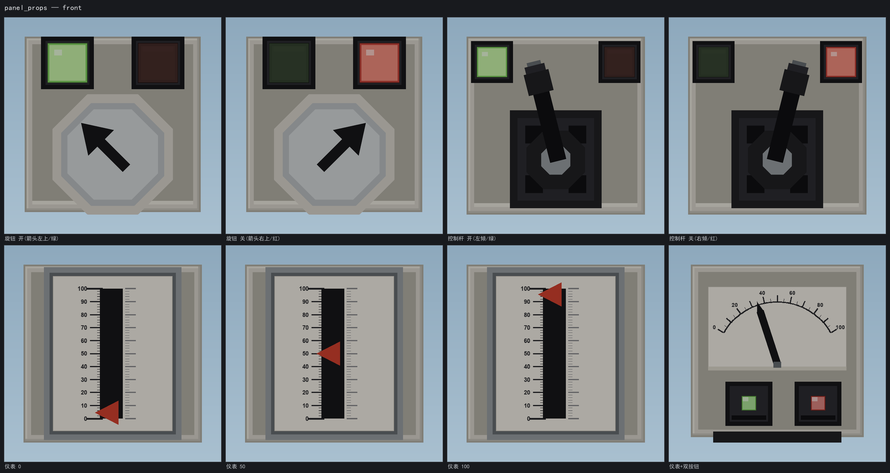
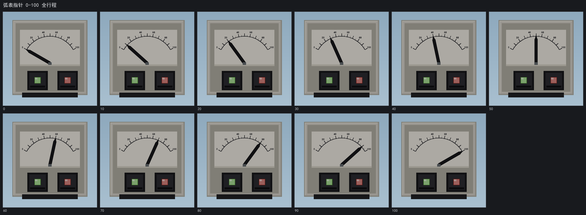
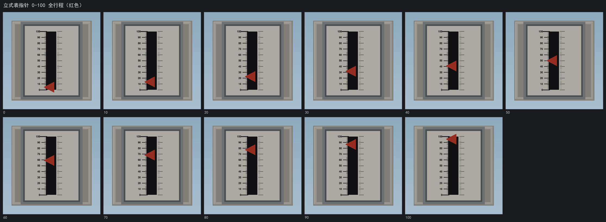

# 控制面板仪表件 · OBJ + 贴图

按你给的 6 张参考截图做的 **4 组低多边形工业仪表**，几何与贴图全部由 `gen.py` 程序化生成，
并在 Blockbench 里打开校验过几何/朝向/贴图映射。

**没有做任何文字**（除了仪表的数字刻度），灯是正方形，旋钮是真正的八边形。



---

## 一、交付内容

```
out/
  obj/
    knob_switch_open.obj / .mtl       旋钮 · 开（箭头左上 + 绿灯亮）
    knob_switch_close.obj / .mtl      旋钮 · 关（箭头右上 + 红灯亮）
    knob_switch.png                   ← 上面两个共用这张贴图
    lever_switch_open.obj / .mtl      控制杆 · 开（杆向左倾 + 绿灯亮）
    lever_switch_close.obj / .mtl     控制杆 · 关（杆向右倾 + 红灯亮）
    lever_switch.png
    gauge_0.obj  gauge_50.obj  gauge_100.obj    立式仪表（指针 0 / 50 / 100）
    gauge.png
    gauge_buttons.obj / .mtl          弧表 + 双按钮（指针 35）
    gauge_buttons.png
previews/                             软件渲染预览（直接渲染 OBJ 文件本身）
gen.py                                生成器：改数字重跑即重出全部产物
```

**箭头/指针是真正的三角面**：旋钮箭头的三角头、立式表指针、弧表针尖都是三角棱柱
（2 个三角面 + 3 个侧面，`f v/vt/vn` 里就是三顶点的面），不是方块堆出来的阶梯；
外壳、面板、灯座仍然是四边形方块。

同目录 `previews/` 的图是**直接渲染 OBJ 文件本身**得到的（软件光栅化 + 贴图采样），
所以预览和交付物保证是同一份东西。

另外 `bb-ysm-agent/models/control-panel-props/` 下放了一个最小 YSM 包（`models/main.json`
+ `textures/default.png`），用 Blockbench 插件打开就能看到 6 个状态并排、贴图已经对上——
只用于校验，正式交付看 `out/`。

---

## 二、坐标约定（重要）

| 项 | 值 |
|---|---|
| 单位 | **1.0 = 1 个方块**（0.0625 = 原版 16px 里的 1px） |
| 上方向 | **+Y** |
| 正面朝向 | **−Z**（模型从 z=0 的安装面向 −z 凸出，最多约 0.30 格） |
| 包围盒 | x ∈ [0,1]、y ∈ [0,1]、z ∈ [−0.44, 0]，正好占满一格 |
| 左右 | **+X 是观察者的左手侧**（正面朝 −Z 时）。绿灯、开方向都在 +X 这一侧 |

Blockbench 的单位是 **16 = 1 方块**（`gen.py` 里的数字就是 0–16 这套），两边换算 ×16 即可。

---

## 三、4 组模型

### 1) 旋钮开关 `knob_switch_*`

* 面板 + 两盏**正方形**灯（灯座 4.2 单位、灯面 3.2 单位正方形，黑框 + 亮面）。
* 旋钮 = **八边形**棱柱三层（底盘 9.6 / 身体 8.2 / 顶盖 7.2 单位宽），
  每层都是「2 条十字带 + 4 片 45° 倒角薄板」拼的正八边形，侧面能看到倒角斜面。
* 顶盖上一条黑色**箭头**（方杆 + 三角形的头），随状态绕轴转 ±45°：
  * 开 → 箭头指**左上**，绿灯亮、红灯灭
  * 关 → 箭头指**右上**，红灯亮、绿灯灭

### 2) 控制杆 `lever_switch_*`

* 两盏正方形灯（左绿右红，放在面板上沿两侧）+ 黑色摇杆底座（四角凹槽）。
* 底座中央小八边形杆座 + 镀铬卡箍环，杆从环中穿出。
* 杆 = 细杆 + 黑色握把 + 灰顶帽，绕底部枢轴左右倾 ±14°：
  * 开 → 向**左**倾（朝绿灯）
  * 关 → 向**右**倾（朝红灯）

### 3) 立式仪表 `gauge_*`

* 灰色框 + 白色表盘，**数字 0–100，0 在下、100 在上**（每 10 一个数字，每 2 一条细刻度），
  黑带两侧都有刻度（和参考图 4/5 的竖向条形表一致）。
* 指针是压在黑带左缘的**红色三角面**（三角棱柱，正面 `#d0402f`、侧面压暗一档），**只在竖直方向滑动**：0 → 50 → 100 三个位置各一个 OBJ。
* 表盘数字由贴图画上去，所以清晰度 = 贴图分辨率（512，字体 Arial Bold）。

### 4) 弧表 + 双按钮 `gauge_buttons`

* 白色表盘上是 **0–100 的弧形刻度**（0 在左、100 在右，每 20 一个数字）。
* 黑色指针（杆 + 三角针尖）绕弧心摆动（这个件是**转动**，不是上下滑）。
* 下方两个方形按钮（左 = 绿点、右 = 红点，用颜色代替「打开/关闭」文字）。

---

## 四、想自己做开关动画时看这里（枢轴 / 行程）

所有转动件的枢轴都写在 OBJ 里对应 `o` 组的几何上，下表单位是**方块**（×16 = Blockbench 单位）：

| 件 | OBJ 组名 | 枢轴 (x, y, z) | 运动 |
|---|---|---|---|
| 旋钮指针 | `Knob` | (0.5000, 0.3500, −0.2750) | 绕 +Z 转 **−45°(开) / +45°(关)**（右手定则） |
| 控制杆 | `Lever` | (0.5000, 0.3750, −0.2250) | 绕 +Z 转 **−14°(开) / +14°(关)** |
| 立式表指针 | `Needle` | 只平移 | y = **0.2094 + 0.0058125 × v**（v = 0…100），行程 0.5814 |
| 弧表指针 | `Needle` | (0.5000, 0.4344, −0.1187) | 绕 +Z 转 **1.2·v − 60 度**（v = 0…100，即 −60°…+60°） |

灯亮/灭有两种做法：

1. **换模型**：直接用 `*_open.obj` / `*_close.obj`（灯色已烘进贴图）。
2. **换 UV**：一张贴图里同时有亮/灭两种灯面（亮灯区域有中心提亮 + 左上高光），
   在代码里把 `LampGreen` / `LampRed` 的正面 UV 指到另一块就行，几何不用换。

---

## 五、指针能走到哪（全行程实测）

两个表的指针都是**独立的 `o Needle` 组**，代码里直接动它就行，下面的范围是实测（渲染逐格查过）：

| 表 | 运动方式 | 0–100 全行程 | 几何安全范围（出这个范围指针会压到白表盘外） |
|---|---|---|---|
| 弧表 `gauge_buttons` | 绕枢轴转 | **−60° … +60°**（120°，正好对上 150°→30° 的弧） | v ∈ **−30 … 130**（|角度| ≤ 96°）；再大就压到表框/面板上 |
| 立式表 `gauge` | 竖向平移 | 行程 **0.5814** 格（y 0.2094 → 0.7908） | v ∈ **−5 … 105**（指针高 1.9 单位，超出会顶出白色表盘） |

* 弧表的 0 在**观察者左侧**（+X），100 在右侧，指针尖端正好落在弧线上；刻度、数字、指针三者线性一致，任意中间值都能停。
* 立式表的**红色**指针压在黑带左缘、指向左侧的数字，0 在下、100 在上，全行程都留在带内。
* 旋钮的箭头、控制杆的杆都是"整组绕枢轴转"，所以**任意角度都能摆**；交付的两个 OBJ 只是把 开/关 两个角度烘进去了。




---

## 六、贴图

* 每件一张 **512×512 PNG**，空白处透明；材质名统一 `prop`（MTL 里 `map_Kd` 已指好）。
* 灯面 = 亮/灭两套区域；面板正面有 1px 斜边（避免大平面死板）。
* 4 件共用一张 1024 图集（`pack/textures/default.png`，给 Blockbench 用），占用约 27%。

---

## 七、改参数重出

```bash
python gen.py
```

`gen.py` 里每件是一个函数（`p_knob` / `p_lever` / `p_gauge` / `p_gbtn`），尺寸全是显式数字；
贴图在 `paint_*` 里，颜色在 `PAL`。`previews/` 是用 OBJ 文件本身做的软件渲染，
所以预览和交付物一定是同一个东西。

两处容易踩的坑（已处理）：

* 正面贴图的 u 轴与模型 x 轴相反 → 贴图里的「左」= 模型 +X = 观察者左侧；指针/旋钮的转角要取反号才对得上刻度。
* 灯面、面板这类「纯色材质」用的是图集里的 4×4 色块，`gen.py` 必须**先登记完所有色块再裁切**每件的 PNG，否则会裁到透明区。

---

## 八、已知取舍

* 造型是 **Minecraft 方块语汇**：八边形旋钮 = 8 个面 + 4 片斜板，圆形灯座 = 阶梯方块，
  近看有棱角，远看/第一人称成立（参考本身也是硬表面风格）。
* 仪表 0–100 按你的要求统一成十进制刻度，没有保留参考里的 `GPM` / `COUNTS PER SECOND` / `VALVE POSITION` 等文字。
* Blockbench 校验包用的是 bedrock 方块格式，**只能表达四边形**，所以包里没有那三处三角面（OBJ 里是完整的）；
  三角面在 OBJ / 游戏渲染器里正常，但导回 Blockbench 方块模型时会被丢掉。
* 没做：指针的数值动画（只给了关键位置的 OBJ + 上面的行程公式）、按钮按下的位移（需要的话把 `BtnOpen`/`BtnClose` 组沿 −Z 平移 0.06 即可）、PBR 法线。
